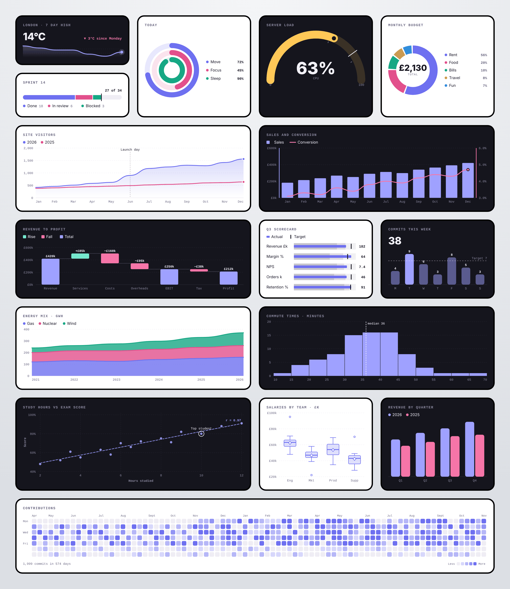

# Bezel Charts

**Charts that look finished the moment you add them.**

[](https://github.com/ShazMoghaddam/bezel-charts/releases)
[](https://www.npmjs.com/package/bezel-charts)
[](https://pypi.org/project/bezel-charts/)
[](https://github.com/ShazMoghaddam/bezel-charts/actions/workflows/ci.yml)
[](https://github.com/ShazMoghaddam/bezel-charts/actions/workflows/python.yml)
[](LICENSE)

Bezel Charts is a set of free, open-source web components: sixteen chart tiles drawn in pure SVG, so they stay sharp on a phone, a 4K screen or a printed report. Build one in the Studio, paste one line of HTML into any site, or save any chart as a static SVG for a README, Notion page or slide, where JavaScript can't run.



**[Open the Studio](https://shazmoghaddam.github.io/bezel-charts/site/#studio)** to build a chart and copy its code.

- **One tag per chart.** `<bezel-bars values="4,9,6">` is a finished, labelled, animated chart.
- **Yours to style.** Any colour, light and dark themes that follow the viewer's setting, rounder or squarer corners, with or without the bezel frame.
- **Made for READMEs.** Every chart exports as a clean static SVG, so a GitHub README can show a real chart.
- **Data science friendly.** Scatter plots with a least-squares trend line and Pearson's r, histograms, box plots, waterfalls, bullet charts, grouped series, goal lines and notes on key points.
- **Speaks your language.** Numbers and dates follow any locale, including Persian.
- **Light.** About 26 kB gzipped for all sixteen charts, or 7 to 12 kB for a page that loads just one. No dependencies and no build step.
- **Accessible.** Tab to any chart and step through its values with the arrow keys. Screen readers hear each value and get a hidden table of the data. Dashes, shapes and patterns tell series apart without relying on colour, and animation respects reduced-motion settings.
- **Python too.** `pip install bezel-charts` draws the same charts straight from a pandas DataFrame, for notebooks, reports and READMEs.

A sibling of [Bezel](https://github.com/ShazMoghaddam/bezel), the clock, calendar and weather tiles.

## Contents

- [Quick start](#quick-start)
- [Load only the charts you use](#load-only-the-charts-you-use)
- [The Studio](#the-studio)
- [The charts](#the-charts)
- [Options for every chart](#options-for-every-chart)
- [Colours and dark mode](#colours-and-dark-mode)
- [Accessibility](#accessibility)
- [Charts in a README](#charts-in-a-readme)
- [JavaScript API](#javascript-api)
- [Python](#python)
- [Frameworks](#frameworks)
- [Development](#development)

## Quick start

```html
<script type="module" src="https://cdn.jsdelivr.net/gh/ShazMoghaddam/bezel-charts@1/dist/bezel-charts.min.js"></script>

<bezel-bars heading="Commits this week" values="4,9,6,3,8,5,3" labels="M,T,W,T,F,S,S" stat="total"></bezel-bars>
```

`@1` always loads the latest 1.x release, so you get fixes without changing anything. To pin an exact version, use `@v1.10.0` instead.

That's all. Charts fill the width of whatever they sit in and redraw when it changes, so they work in a sidebar, a card grid or a full-width section without extra CSS.

Prefer a classic script tag? `dist/bezel-charts.iife.js` registers the same elements and exposes a `BezelCharts` global.

With npm:

```sh
npm install bezel-charts
```

```js
import 'bezel-charts';                      // registers every element
import { render, toSVG } from 'bezel-charts'; // draw charts as SVG strings, even in Node
```

## Load only the charts you use

Each chart also comes as its own file, so a page with a single chart loads less than half the full bundle. The files share their common code, so a page with two or three charts downloads that part once.

```html
<script type="module" src="https://cdn.jsdelivr.net/gh/ShazMoghaddam/bezel-charts@1/dist/charts/line.js"></script>
<script type="module" src="https://cdn.jsdelivr.net/gh/ShazMoghaddam/bezel-charts@1/dist/charts/bars.js"></script>
```

```js
import 'bezel-charts/line';
import 'bezel-charts/bars';
import { toSVG } from 'bezel-charts/line'; // render and toSVG work for every chart loaded so far
```

| Page | Gzipped |
| --- | --- |
| One sparkline, ring, donut, gauge, progress bar or heatmap | 7.3 to 7.5 kB |
| One waterfall, bullet, histogram, box plot, scatter, bar or bars-and-line chart | 9.0 to 10.5 kB |
| One line or area chart | 12.0 to 12.4 kB |
| A line and a bar chart | 15.1 kB |
| Every chart: the full bundle | 25.9 kB |

Once a page needs four or five different charts, load the full bundle instead. `<bezel-chart type="…">` works with whichever charts are loaded, and tells you which file to add if its type isn't one of them. The classic `iife.js` script always has every chart, because a classic script can't load the shared file.

## The Studio

The [Studio](https://shazmoghaddam.github.io/bezel-charts/site/#studio) is the easiest way to make a chart. No data to hand? Press one of the three sample files under **Import a file** to see a finished chart straight away, or download them from [`site/samples`](site/samples). Then pick a chart type then work through the tabs while the preview updates beside them:

- **Data:** the title, your numbers, labels and series. **Import a file** (CSV, Excel .xlsx or JSON), drop one onto the Studio, or paste cells straight from Excel, Numbers or Google Sheets, and it fills the values, series names and labels in one go.
- **Style:** theme, frame, corners, height, colours and how numbers are written.
- **Extras:** headline number, goal line, notes on key points, and the options that suit that chart, such as a trend line on a scatter plot.

The Studio only offers settings that change the chart you're editing. When you're done, **Copy HTML** gives you the script line and your chart's tag, ready to paste into a page. Untick **Include the script line** when the page already has it. **Save SVG** gives you an image file, and **Copy link** opens your exact chart in the Studio for someone else. The **Customise** button under every example on the site opens that example in the Studio.

### Importing data

The Studio reads the first sheet of an Excel file, CSV (comma or semicolon separated, quoted cells are fine) and JSON. It looks at your columns and fills in the chart for you:

- A text column becomes the labels, and number columns become the values. Line and bar charts take up to six number columns as series; Bars switches to Grouped bars when there's more than one.
- A scatter plot uses the first two number columns for across and up. A text column with a few repeated values, like a team name, splits the points into groups.
- A heatmap uses a date column (2026-03-01, 01/03/2026 or Excel dates) and adds up the values for each day.
- Currency signs and thousands separators are understood, so `£1,200` reads as 1200.

Units are picked up too: a column called `Distance (km)` gets " km" after its numbers, and cells like `£1,200` or `45%` set the £ or %. Dates used as labels are shortened to "1 Jan".

The imported data stays when you switch chart type, so you can try it as a line, then bars, then a donut. **Start over with sample data** clears it. Files stay in your browser: nothing is uploaded.

No file to hand? The Studio has three to try, which you can also download from [`site/samples`](site/samples): monthly sales (grouped bars), study hours against exam scores (a scatter plot with trend lines) and a year of daily runs (a heatmap).

```json
[
  { "month": "Jan", "sales": 1200, "costs": 800 },
  { "month": "Feb", "sales": 1500, "costs": 900 }
]
```

## The charts

Values can be separated with commas, spaces or new lines. Labels are separated with commas.

### `<bezel-spark>`

A sparkline with the latest value up front and its change since the start.

```html
<bezel-spark heading="London · 7 day high" values="17,16,15,15,13,12,14" labels="Mon,Tue,Wed,Thu,Fri,Sat,Sun" suffix="°C"></bezel-spark>
```

| Attribute     | Values                                      | Default |
| ------------- | ------------------------------------------- | ------- |
| `values`      | numbers                                     |         |
| `labels`      | one per value, shown in tooltips            |         |
| `height`      | chart height in px                          | `64`    |
| `straight`    | boolean, straight lines instead of curves   | off     |

Also takes `stat`, `goal`, `notes` and `show-values` from [the shared options](#options-for-every-chart). `stat` is `last` by default here.

### `<bezel-line>`

One or more lines over time, with an axis, a legend and notes on key moments. Separate series with `|`.

```html
<bezel-line heading="Site visitors"
  values="420,460,510,580,620,900|380,400,430,450,470,490"
  series="2026,2025" labels="Jan,Feb,Mar,Apr,May,Jun" notes="Jun:Launch day"></bezel-line>
```

| Attribute     | Values                                      | Default |
| ------------- | ------------------------------------------- | ------- |
| `values`      | numbers, series separated by `\|`           |         |
| `series`      | series names for the legend                 |         |
| `labels`      | one per point, along the bottom             |         |
| `height`      | chart height in px                          | `170`   |
| `zero`        | boolean, start the axis at zero             | off     |
| `straight`    | boolean, straight lines instead of curves   | off     |
| `dash`        | a line style per series: `solid`, `dashed`, `dotted`, `dashdot`. On its own, gives each series the next style | off |
| `markers`     | a shape on each point, per series: `circle`, `square`, `triangle`, `diamond`, `none`. On its own, gives each series the next shape | off |
| `dates`       | one date per point, `2026-01-05` or `2026-01-05T14:30`: points sit where they fall in time | evenly spaced |
| `min`, `max`  | fix the value axis; anything beyond is clipped at the edge, and the tooltip keeps the true value | from the data |
| `log`         | boolean, a log scale: each power of ten gets the same height | off |

**Dates.** With `dates`, a reading on 1 January, one on 2 January and one on 1 March sit where they fall, instead of evenly spaced. The axis picks its own step for the span and the width: hours (`14:00`), days or weeks (`5 Jan`), months (`Jan 2026`, then `Feb`, `Mar`), or years. Tooltips and the data table show the full date, and `labels`, if you give them, still name the points. Dates are read as written, with no time zone conversion.

**Log scale.** `log` suits values that grow fast, like users or prices over years: 100, 1,000, 10k and 100k sit evenly apart. Zero and negative values have no place on a log scale, so the line leaves a gap there, and the tooltip and data table still show them.

### `<bezel-area>`

Filled areas over time. Several series overlap as see-through fills, or add `stacked` to pile them up so the top edge is the total, or `stacked="percent"` to show how each total splits. The axis always starts at zero, since an area's height reads as an amount.

```html
<bezel-area heading="Energy mix · GWh" values="120,130,125,140,150,160|80,85,90,88,95,100|40,45,60,70,85,110"
  series="Gas,Nuclear,Wind" labels="2021,2022,2023,2024,2025,2026" stacked></bezel-area>
```

| Attribute     | Values                                                   | Default |
| ------------- | -------------------------------------------------------- | ------- |
| `values`      | numbers, series separated by `\|`                        |         |
| `series`      | series names for the legend                              |         |
| `labels`      | one per point, along the bottom                          |         |
| `stacked`     | with several series: on its own to pile them up, or `percent` to scale each column to 100% | off |
| `height`      | chart height in px                                       | `170`   |
| `straight`    | boolean, straight edges instead of curves                | off     |
| `dash`, `markers` | styles for each series' top edge, as on line charts  | off     |
| `patterns`    | a fill per series, as on bars                            | off     |
| `dates`       | one date per point, as on line charts                    | evenly spaced |
| `max`, `min`  | fix the value axis, as on line charts; `min` only at or below zero, so areas keep their base | from the data |

The tooltip lists every series, plus the total when stacked, and each series' share in a percent stack. `show-values` writes each value, or the total above each column of a stack. Negative values stack below zero, as stacked bars do, but stacks read best when every value is positive: bands that swing between positive and negative cross over each other.

### `<bezel-bars>`

Bars, vertical or horizontal. Give it more than one series and you get **grouped bars**, side by side with a legend, or add `stacked` to pile each group's series into one bar.

```html
<bezel-bars heading="Revenue by quarter" values="182000,214000,236000,268000|151000,170000,198000,205000"
  series="2026,2025" labels="Q1,Q2,Q3,Q4" prefix="£" compact></bezel-bars>
```

| Attribute     | Values                                                   | Default |
| ------------- | -------------------------------------------------------- | ------- |
| `values`      | numbers, series separated by `\|`                        |         |
| `series`      | series names for the legend                              |         |
| `labels`      | one per bar or group                                     |         |
| `horizontal`  | boolean, bars run left to right with labels beside them  | off     |
| `stacked`     | boolean, with several series, piles them into one bar per group | off |
| `angle-labels` | boolean, slants labels under vertical bars when they don't fit side by side, so every one shows | off |
| `patterns`    | with several series, a fill per series: `solid`, `stripes`, `dots`, `grid`. On its own, gives each series the next pattern | off |
| `highlight`   | `none` to stop the highest bar standing out              | on      |
| `height`      | chart height in px (vertical bars)                       | `140`   |

With a single series and several colours in `color`, each bar takes its own colour.

Stacked bars put positive parts above zero and negative parts below it. The tooltip lists every part and the total, and `show-values` writes the total at the end of each bar. Horizontal stacked bars always show the total.

```html
<bezel-bars heading="Land in a flood zone" values="18.4,16.6,0.1|6.6,24.8,33"
  series="Low or higher,Very Low" labels="Barking and Dagenham,Newham,Southwark"
  suffix="%" decimals="1" stacked angle-labels></bezel-bars>
```

Without `angle-labels`, labels that don't fit take turns, so only every few are shown. With it, they lean at 40 degrees and every one shows, shortened after 24 characters. The tooltip always has the full label.

### `<bezel-combo>`

Bars and lines with different units on one chart, such as sales in pounds as bars and conversion in percent as a line. Bars read against the left axis and lines against the right.

```html
<bezel-combo heading="Sales and conversion" values="182,214,236,268" line="3.1,3.4,3.6,4.2"
  series="Sales" line-series="Conversion" labels="Q1,Q2,Q3,Q4" prefix="£" suffix="k" line-suffix="%"></bezel-combo>
```

| Attribute       | Values                                                        | Default |
| --------------- | ------------------------------------------------------------- | ------- |
| `values`        | bar numbers, series separated by `\|`                         |         |
| `line`          | line numbers, lines separated by `\|`                         |         |
| `series`, `line-series` | names for the bars and the lines                       |         |
| `labels`        | one per column, along the bottom                              |         |
| `stacked`       | with several bar series, pile them up                         | side by side |
| `line-prefix`, `line-suffix`, `line-decimals` | number formatting for the right axis and the line values | |
| `y-label`, `line-label` | titles above the left and right axes                  |         |
| `line-zero`     | boolean, start the right axis at zero                         | off     |
| `dash`, `markers`, `patterns` | styles for the lines and the bars               | off     |
| `height`        | chart height in px                                            | `200`   |

Two scales on one chart are easy to misread, so the right axis always has the same number of steps as the left: every gridline reads on both sides. A rule down each side takes its data's colour, so it's clear which axis belongs to what. The bar axis always includes zero; the line axis fits its data unless you add `line-zero`. The tooltip gives every value in its own units, with the total when stacked.

### `<bezel-waterfall>`

How a starting value rises and falls, step by step, to where it ends up: revenue down to profit, or a budget across the year. Give it the changes, and name the bars that show the running total.

```html
<bezel-waterfall heading="Revenue to profit" values="420,85,-160,-95,0,-38,0"
  labels="Revenue,Services,Costs,Overheads,EBIT,Tax,Profit" totals="Revenue,EBIT,Profit" prefix="£" suffix="k"></bezel-waterfall>
```

| Attribute     | Values                                                          | Default |
| ------------- | --------------------------------------------------------------- | ------- |
| `values`      | the changes, in order: rises positive, falls negative           |         |
| `labels`      | one per step, along the bottom                                  |         |
| `totals`      | the bars that show the running total, by label or by position counting from `0` | none |
| `series`      | names for the legend: rise, fall and total                      | `Rise,Fall,Total` |
| `color`       | up to three colours: rise, fall and total                       | the theme's up, down and first colours |
| `goal`        | a reference line                                                |         |
| `height`      | chart height in px                                              | `200`   |

A total adds its own value first, then shows the running total from zero. So give the opening amount for a start bar and `0` for a subtotal or the end. Changes float from the previous level, joined by a thin step line. Every bar carries a signed label (`+£85k`, `−£160k`), so rises and falls read without relying on colour; if any label would overlap its neighbour, they all hide and the tooltips and data table still give each change and running total. A label that looks like a number, such as a year, wins over a position in `totals`.

### `<bezel-histogram>`

How raw values spread out. Give it the values themselves, such as 500 customers' ages, and it counts how many fall into each range. The ranges get round edges (20, 30, 40, not 19.7, 31.4) and a sensible number for the amount of data.

```html
<bezel-histogram heading="Commute times · minutes" values="34,28,41,22,37,30,45,26,33,52,29,38" mark="median"></bezel-histogram>
```

| Attribute     | Values                                                     | Default |
| ------------- | ---------------------------------------------------------- | ------- |
| `values`      | raw numbers, series separated by `\|`                      |         |
| `series`      | series names for the legend                                |         |
| `bins`        | roughly how many ranges                                    | about log₂(n) + 1 |
| `bin-width`   | an exact width for each range, such as `5`                 | automatic |
| `mark`        | `mean`, `median` or `mean,median`: a labelled line for each | none    |
| `percent`     | boolean, shares instead of counts, so groups of different sizes compare | off |
| `patterns`    | with several series, a fill each, as on bars               | off     |
| `height`      | chart height in px                                         | `190`   |

Each range includes its lower edge but not its upper one, except the last, which includes both, so the largest value always counts. Several series share the same ranges and overlap, so their spreads compare directly. `prefix`, `suffix` and `decimals` format the range edges. If you have already counted, use `<bezel-bars>` instead.

### `<bezel-boxplot>`

Box plots compare spreads side by side: one box per group of raw values. The box runs from the lower to the upper quartile, so it holds the middle half of the values, with a line at the median. The whiskers reach the furthest values within one and a half box heights, and anything further out is drawn as a dot.

```html
<bezel-boxplot heading="Salaries by team · £k" values="58,62,64,71,66,95|44,47,52,49,22|50,55,61,57" series="Engineering,Marketing,Product" prefix="£" suffix="k" mark="mean"></bezel-boxplot>
```

| Attribute     | Values                                                         | Default |
| ------------- | -------------------------------------------------------------- | ------- |
| `values`      | raw numbers, one group per series, separated by `\|`           |         |
| `series`      | a name for each group                                          |         |
| `whiskers`    | `range` to reach the lowest and highest values, with no outlier dots | 1.5 × the box |
| `mark`        | `mean` for a diamond at the mean                               | none    |
| `horizontal`  | boolean, lay the boxes on their side                           | off     |
| `color`       | one colour, or one per box                                     | theme   |
| `height`      | chart height in px                                             | `200`   |

Quartiles are calculated the way pandas, NumPy and Excel's `QUARTILE.INC` do, so the numbers match `df.describe()`. The tooltip gives each group's median, middle half, range, outliers and count, and the hidden table lists every figure.

### `<bezel-scatter>`

How two measures move together. Pass matching `x` and `y` lists; separate groups with `|`.

```html
<bezel-scatter heading="Study hours vs exam score"
  x="2,3,4,5,6,7,8,9,10" y="48,52,55,63,70,72,75,82,88"
  x-label="Hours studied" y-label="Score" suffix="%" trend></bezel-scatter>
```

| Attribute     | Values                                                         | Default |
| ------------- | -------------------------------------------------------------- | ------- |
| `x`, `y`      | numbers, one of each per point, groups separated by `\|`       |         |
| `series`      | group names for the legend                                     |         |
| `labels`      | point names, shown in tooltips                                 |         |
| `x-label`, `y-label` | axis titles                                             |         |
| `trend`       | boolean, a least-squares line per group with Pearson's r      | off     |
| `markers`     | a point shape per group: `circle`, `square`, `triangle`, `diamond`. On its own, gives each group the next shape | circles |
| `zero`        | boolean, start the y axis at zero                              | off     |
| `height`      | chart height in px                                             | `210`   |

`prefix`, `suffix` apply to y. Notes point at a point by its position, counting from 0 across all groups, or by its label.

### `<bezel-ring>`

A progress ring, or several nested like an activity tracker.

```html
<bezel-ring heading="Today" values="72,45,90" labels="Move,Focus,Sleep"></bezel-ring>
```

| Attribute     | Values                                      | Default |
| ------------- | ------------------------------------------- | ------- |
| `values`      | one number per ring                         |         |
| `labels`      | one per ring                                |         |
| `max`         | the value that fills a ring                 | `100`   |
| `height`      | chart height in px                          | `140`   |

With `max` at 100 and no `prefix` or `suffix`, values show as percentages.

### `<bezel-donut>`

How a total splits into parts. More than six slices are grouped into "Other".

```html
<bezel-donut heading="Monthly budget" values="1200,420,210,160,140" labels="Rent,Food,Bills,Travel,Fun" prefix="£"></bezel-donut>
```

| Attribute      | Values                       | Default  |
| -------------- | ---------------------------- | -------- |
| `values`       | one number per slice         |          |
| `labels`       | one per slice                |          |
| `center-label` | the word under the total     | `Total`  |
| `height`       | chart height in px           | `150`    |

### `<bezel-gauge>`

A reading on a scale, optionally coloured by zone.

```html
<bezel-gauge heading="Server load" values="63" labels="CPU" zones="60,85" goal="80"></bezel-gauge>
```

| Attribute     | Values                                                          | Default |
| ------------- | --------------------------------------------------------------- | ------- |
| `values`      | the reading                                                     |         |
| `labels`      | a caption under the reading                                     |         |
| `min`, `max`  | the ends of the scale                                           | `0`, `100` |
| `zones`       | breakpoints, e.g. `60,85`: green, then amber, then red          |         |
| `goal`        | a marker on the scale                                           |         |
| `height`      | chart height in px                                              | `130`   |

Pass several colours in `color` to choose the zone colours yourself.

### `<bezel-progress>`

A progress bar, or stacked parts against a target.

```html
<bezel-progress heading="Sprint 14" values="18,6,3" labels="Done,In review,Blocked" max="34" goal="27"></bezel-progress>
```

| Attribute     | Values                                       | Default |
| ------------- | -------------------------------------------- | ------- |
| `values`      | one number, or one per segment               |         |
| `labels`      | one per segment                              |         |
| `max`         | the full length of the bar                   | `100` for one value, otherwise the total |
| `goal`        | a marker on the bar                          |         |

### `<bezel-bullet>`

Bullet charts: one row per measure, comparing the actual value with its target against bands for poor, fair and good. A compact choice for a KPI scorecard.

```html
<bezel-bullet heading="Q3 scorecard" values="182,64,7.4" targets="200,60,8" labels="Revenue £k,Margin %,NPS"
  zones="150,180|40,55|6,7" zone-labels="Poor,Fair,Good"></bezel-bullet>
```

| Attribute     | Values                                                          | Default |
| ------------- | --------------------------------------------------------------- | ------- |
| `values`      | the actual values, one per row                                  |         |
| `targets`     | one per row, or one number for every row, drawn as an upright line |      |
| `labels`      | one per row, on the left                                        |         |
| `zones`       | band edges, the same as the gauge: `150,180` makes three bands. Give each row its own with `\|` |  |
| `zone-labels` | names for the bands, shown in tooltips and the data table       | `2 of 3` |
| `max`         | the same end for every row                                      | each row fits its own numbers |
| `series`      | names for the legend: actual and target                         | `Actual,Target` |
| `color`       | one colour, or one per row                                      | theme   |

Each row has its own scale from zero, so measures in different units sit together. The bands use one grey, darkest at the low end, so they read in greyscale and in print. The summary counts how many measures meet their target, and the tooltip and data table give the actual, target, difference and band.

### `<bezel-heatmap>`

Activity by day, GitHub style, with Monday at the top.

```html
<bezel-heatmap heading="Contributions" start="2026-01-01" values="0,3,5,1,0,2,8,4" suffix=" commits"></bezel-heatmap>
```

| Attribute     | Values                                      | Default |
| ------------- | ------------------------------------------- | ------- |
| `values`      | one number per day                          |         |
| `start`       | the first day, `YYYY-MM-DD`                 | so the last value is today |

On narrow screens the heatmap shows the most recent weeks that fit rather than shrinking the squares.

### `<bezel-chart>`

Any of the above, picked with `type`: `<bezel-chart type="donut" values="3,2,1">`. Handy when the chart type comes from data.

## Options for every chart

| Attribute       | Values                                                          | Default       |
| --------------- | --------------------------------------------------------------- | ------------- |
| `heading`       | a title above the chart                                         |               |
| `prefix`        | text before numbers, e.g. `£`                                   |               |
| `suffix`        | text after numbers, e.g. `%` or ` kg`                           |               |
| `decimals`      | decimal places, `0` to `6`                                      | automatic     |
| `compact`       | boolean, writes big numbers short, e.g. `12.5k`                 | off           |
| `lang`          | a locale for numbers and dates, e.g. `fr-FR`, `fa-IR`           | `en-GB`       |
| `theme`         | `auto`, `dark`, `light`                                         | `auto`        |
| `frame`         | `bezel`, `none`                                                 | `bezel`       |
| `corners`       | corner radius in px                                             | `22`          |
| `color`         | one colour, or a comma list for series, slices or zones         | theme palette |
| `background`    | the tile colour                                                 | from theme    |
| `stat`          | a headline number: `last`, `total`, `average`, `max`, `min`, `none` | `none`    |
| `delta`         | with `stat="last"`: `inverse` when falling is good, `none` to hide the change |  |
| `delta-label`   | wording after the change                                        | `since start` |
| `goal`          | a dashed goal line, or a marker on gauges and progress bars     |               |
| `goal-label`    | wording for the goal line                                       | `Goal`        |
| `notes`         | `point:text` pairs separated by `;`, e.g. `Jun:Launch;9:Peak`. A point is a label or, if no label matches, a position counted from 0 | |
| `show-values`   | boolean, writes each value on the chart                         | off           |
| `width`         | a fixed width in px instead of filling the container            |               |
| `no-tooltips`   | boolean, turns off hover, tap and keyboard values, and leaves the chart out of the Tab order | off |
| `static`        | boolean, skips the entrance animation                           | off           |
| `clickable`     | boolean, a pointer over each value and an Enter hint for screen readers, when you handle `bezel-click` | off |

Not every option suits every chart: `notes` works on spark, line, area and scatter; `show-values` on spark, line, area and bars; `goal-label` on spark, line, area, bars and scatter; `stat` on everything except the gauge and scatter. The Studio only shows what applies.

## Colours and dark mode

With `theme="auto"` (the default) a chart follows the viewer's light or dark setting, and redraws when it changes. A page can also force one by setting `data-theme="light"` or `data-theme="dark"` on `<html>`. Each theme has its own palette, picked to read well on its background:

| Theme | Palette |
| ----- | ------- |
| Dark  | `#9FA1FF` `#F675A8` `#5EE6C8` `#FFC857` `#7CC4FF` `#FF8A5B` |
| Light | `#6E70F0` `#E2508C` `#16A884` `#D99A0E` `#2F8FE0` `#EE6431` |

Set `color` to use your own. Colours you set stay the same in both themes, so choose ones with enough contrast against both tile colours, or set `theme` to fix one.

## Accessibility

Every chart works without a mouse and without seeing it.

**Keyboard.** Press Tab to reach a chart. A focus ring shows where you are, then:

| Key | Does |
| --- | --- |
| Right or Down | The next value |
| Left or Up | The previous value |
| Home, End | The first or last value |
| Enter, Space | Selects the value, firing `bezel-click` |
| Escape | Hides the tooltip |

The value you're on is outlined, with its tooltip showing. On a heatmap, Left and Right move a week and Up and Down move a day, following the grid. A chart keeps its place when it redraws, for example when the window resizes.

**Screen readers** hear the chart's name and summary, a hint about the arrow keys, and each value as you move, such as "Tue: 9. 2 of 7". Each chart also carries a hidden table of its data, with every value, including the small donut slices grouped as "Other" and the early weeks a narrow heatmap leaves out.

**Telling series apart.** Colour alone isn't enough for everyone, so lines can have their own dash, points their own shape, and grouped or stacked bars their own pattern. Use the attribute on its own to hand out styles in turn, or list one per series, in the same order as `color`:

```html
<bezel-line values="420,460,510|380,400,430" series="2026,2025" dash markers></bezel-line>
<bezel-bars values="4,9,6|3,7,8" series="2026,2025" labels="Q1,Q2,Q3" patterns="solid,stripes"></bezel-bars>
```

The legend shows each style, so it still matches the chart in black and white.

**Fewer tab stops.** A page with many charts gets a tab stop for each. Add `no-tooltips` to a chart that doesn't need exact values, such as a decorative sparkline: it drops the tooltips and the tab stop, and keeps the name and the hidden table.

**Images.** An exported SVG is a picture, so give it alt text that says what it shows: ``. The Python package writes this for you with `chart.alt`.

## Charts in a README

GitHub doesn't run scripts in a README, but it shows SVG images. So:

1. Build your chart in the [Studio](https://shazmoghaddam.github.io/bezel-charts/site/#studio) and press **Save SVG**. The image is drawn at the preview width.
2. Commit the file to your repository, e.g. `docs/commits.svg`.
3. Add it to your README:

```md

```

Make the alt text say what the chart shows, since that's all a screen reader gets from an image.

The SVG is self-contained: no scripts, no fonts to load, no tooltips. It uses the system font, so it looks at home on GitHub, in Notion and in slides.

## JavaScript API

Every chart element has:

- `toSVG()`: the chart as a static SVG string.
- `download(name)`: saves the chart as an `.svg` file.
- `data`: options as real arrays and numbers, set from JavaScript (below).
- `options`: the current settings as a plain object.
- `refresh()`: redraws without replaying the animation.

It fires a `bezel-render` event each time it draws, and `bezel-click` when someone picks a value.

### Data from JavaScript

Attributes are text, so from JavaScript it's simpler to hand the chart real arrays. `data` takes any options, and the chart redraws:

```js
const chart = document.querySelector('bezel-bars');
chart.data = { values: [[182, 214, 236], [151, 170, 198]], labels: ['Q1', 'Q2', 'Q3'], series: ['2026', '2025'] };
```

Several series are nested arrays. Anything in `data` wins over the matching attribute, so HTML can set the look (`heading`, `prefix`, `theme`) and JavaScript the numbers. Keys can be camelCase (`showValues`) or as written in HTML (`'show-values'`). Set `chart.data = null` to go back to the attributes alone. Large datasets skip the round trip through text, and `data` set before the chart's script has loaded is kept.

### Clicks

Clicking a bar, point, slice, row or day fires `bezel-click`. So does pressing Enter or Space on the value the arrow keys are on, so keyboard users can do the same as mouse users.

```js
chart.addEventListener('bezel-click', (e) => {
  const { index, label, value } = e.detail;
  showDetails(label, value); // for example, open the month someone picked
});
```

| `e.detail` | Holds |
| --- | --- |
| `type` | the chart type, such as `bars` |
| `index` | the item's position, counting from 0: the column, bar, slice, row or day. On a scatter, the point's position across all groups, the same as `labels` and `notes` use |
| `series`, `seriesName` | the series index and name when the item belongs to one series (scatter points, box plots), otherwise `null` |
| `label` | the item's label, if it has one |
| `value` | the number. Where an item covers several series, such as a column on a line chart, one per series, with `null` for a series that's shorter. A scatter point gives `[x, y]`, a box plot its median, a histogram its count per series, a waterfall the change, and bars and a line the bars then the lines |
| `text` | the tooltip text, with everything the chart shows for that item |

A chart can't tell whether anything is listening, so it doesn't change the cursor on its own. Add `clickable` to show a pointer over each value and tell screen reader users they can press Enter to select one.

The module also exports `render(type, options)` and `toSVG(type, options)`, which return SVG strings without touching the DOM. They take the same option names as the attributes and run anywhere, including Node:

```js
import { toSVG } from 'bezel-charts';
import { writeFileSync } from 'node:fs';

writeFileSync('downloads.svg', toSVG('bars', { heading: 'Downloads', values: [120, 340, 410], labels: 'Jan,Feb,Mar', width: 480 }));
```

## Python

The [Python package](python/) draws the same charts from a pandas DataFrame, a NumPy array or a plain list, with no dependencies. Charts show up in Jupyter and save as static SVGs:

```sh
pip install bezel-charts
```

```python
import bezel_charts as bc

bc.line(df, x="month", y=["sales", "costs"], heading="Sales", prefix="£")
bc.spark(df["signups"], heading="Signups").save("docs/signups.svg")
```

All sixteen charts are available, and the Python output matches the JavaScript byte for byte, checked in CI. `chart.alt` gives ready-made alt text for the saved image. See the [Python README](python/README.md).

## Frameworks

Bezel Charts are standard custom elements, so they work anywhere HTML does. Pass arrays through `data`, set everything else as attributes, and listen for `bezel-click`.

**React 19+**

```jsx
import 'bezel-charts';

<bezel-line heading="Sales" data={{ values: sales, labels: months }} onbezel-click={(e) => setMonth(e.detail.label)} />
```

React 19 sets `data` as a property because the element has one, so import Bezel Charts before the chart first renders. React 18 and earlier pass everything as text: use `values={sales.join(',')}` there.

**Vue**

```vue
<bezel-donut heading="Budget" :data.prop="{ values: parts, labels: names }" @bezel-click="pick" />
```

In Vue, tell the compiler these are custom elements with `compilerOptions.isCustomElement: (tag) => tag.startsWith('bezel-')`.

## Development

```sh
git clone https://github.com/ShazMoghaddam/bezel-charts.git
cd bezel-charts
npm install
npm run serve        # http://localhost:4173/site/
npm run check        # build, run the tests, and check the size budget
npm run test:browser # click through every Studio control in a real browser (needs Python and Playwright)
```

```
src/
  core/        shared helpers, the bezel frame and the colour themes; series.js has the extras for line, area, bars
               and scatter, and xy.js the axis frame line and area charts share
  charts/      one file per chart type: options in, SVG string out
  render.js    picks the chart and returns its SVG
  element.js   the custom element: sizing, theme, tooltips, keyboard and export
  entries/     one file per chart that registers it and defines its tag, for per-chart imports
site/          the website and Studio, with sample files in site/samples
python/        the Python package, with parity tests against the JavaScript
docs/          the README image and social preview, with the pages that render them
test/          node:test suites, plus a Playwright browser test
```

Each chart is a pure function that takes its options and a theme and returns an SVG string, which keeps them easy to test and lets the same code run in Node. The full bundle has a 26 kB gzip budget and each chart file its own, checked in CI by `npm run size`. See [CONTRIBUTING.md](CONTRIBUTING.md).

## Security

Found a security problem? Please report it privately through GitHub rather than in an issue. [SECURITY.md](SECURITY.md) explains how, and which versions get fixes.

## Credits

Typeface Geist (SIL Open Font License) on the website; the charts themselves use the system font. Designed and built by [Shaz Moghaddam](https://shazmoghaddam.github.io), London.

## Licence

[MIT](LICENSE)
