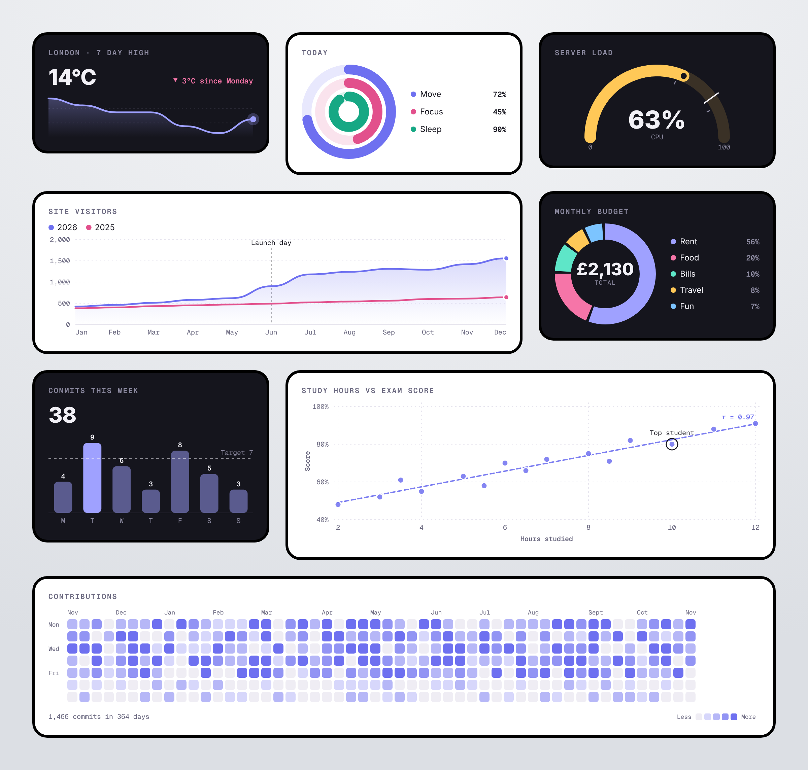

# Bezel Charts

**Charts that look finished the moment you add them.**

Bezel Charts is a set of free, open-source web components: ten chart tiles drawn in pure SVG, so they stay sharp on a phone, a 4K screen or a printed report. Build one in the Studio, paste one line of HTML into any site, or save any chart as a static SVG for a README, Notion page or slide, where JavaScript can't run.



**[Open the Studio](https://shazmoghaddam.github.io/bezel-charts/site/#studio)** to build a chart and copy its code.

- **One tag per chart.** `<bezel-bars values="4,9,6">` is a finished, labelled, animated chart.
- **Yours to style.** Any colour, light and dark themes that follow the viewer's setting, rounder or squarer corners, with or without the bezel frame.
- **Made for READMEs.** Every chart exports as a clean static SVG, so a GitHub README can show a real chart.
- **Data science friendly.** Scatter plots with a least-squares trend line and Pearson's r, grouped series, goal lines and notes on key points.
- **Speaks your language.** Numbers and dates follow any locale, including Persian.
- **Light.** About 12 kB gzipped with no dependencies and no build step.
- **Accessible.** Every chart describes itself to screen readers, shows exact values on hover or tap, and respects reduced-motion settings.
- **Python too.** `pip install bezel-charts` draws the same charts straight from a pandas DataFrame, for notebooks, reports and READMEs.

A sibling of [Bezel](https://github.com/ShazMoghaddam/bezel), the clock, calendar and weather tiles.

## Contents

- [Quick start](#quick-start)
- [The Studio](#the-studio)
- [The charts](#the-charts)
- [Options for every chart](#options-for-every-chart)
- [Colours and dark mode](#colours-and-dark-mode)
- [Charts in a README](#charts-in-a-readme)
- [JavaScript API](#javascript-api)
- [Python](#python)
- [Frameworks](#frameworks)
- [Development](#development)

## Quick start

```html
<script type="module" src="https://cdn.jsdelivr.net/gh/ShazMoghaddam/bezel-charts@1/dist/bezel-charts.min.js"></script>

<bezel-bars heading="Commits this week" values="4,9,6,3,8,5,3" labels="M,T,W,T,F,S,S" stat="total"></bezel-bars>
```

`@1` always loads the latest 1.x release, so you get fixes without changing anything. To pin an exact version, use `@v1.0.1` instead.

That's all. Charts fill the width of whatever they sit in and redraw when it changes, so they work in a sidebar, a card grid or a full-width section without extra CSS.

Prefer a classic script tag? `dist/bezel-charts.iife.js` registers the same elements and exposes a `BezelCharts` global.

With npm, straight from GitHub:

```sh
npm install github:ShazMoghaddam/bezel-charts
```

```js
import 'bezel-charts';                      // registers every element
import { render, toSVG } from 'bezel-charts'; // draw charts as SVG strings, even in Node
```

## The Studio

The [Studio](https://shazmoghaddam.github.io/bezel-charts/site/#studio) is the easiest way to make a chart. No data to hand? Press one of the three sample files under **Import a file** to see a finished chart straight away, or download them from [`site/samples`](site/samples). Then pick a chart type then work through the tabs while the preview updates beside them:

- **Data:** the title, your numbers, labels and series. **Import a file** (CSV, Excel .xlsx or JSON), drop one onto the Studio, or paste cells straight from Excel, Numbers or Google Sheets, and it fills the values, series names and labels in one go.
- **Style:** theme, frame, corners, height, colours and how numbers are written.
- **Extras:** headline number, goal line, notes on key points, and the options that suit that chart, such as a trend line on a scatter plot.

The Studio only offers settings that change the chart you're editing. When you're done, **Copy HTML** gives you the script line and your chart's tag, ready to paste into a page. Untick **Include the script line** when the page already has it. **Save SVG** gives you an image file, and **Copy link** opens your exact chart in the Studio for someone else. The **Customise** button under every example on the site opens that example in the Studio.

### Importing data

The Studio reads the first sheet of an Excel file, CSV (comma or semicolon separated, quoted cells are fine) and JSON. It looks at your columns and fills in the chart for you:

- A text column becomes the labels, and number columns become the values. Line and bar charts take up to six number columns as series; Bars switches to Grouped bars when there's more than one.
- A scatter plot uses the first two number columns for across and up. A text column with a few repeated values, like a team name, splits the points into groups.
- A heatmap uses a date column (2026-03-01, 01/03/2026 or Excel dates) and adds up the values for each day.
- Currency signs and thousands separators are understood, so `£1,200` reads as 1200.

Units are picked up too: a column called `Distance (km)` gets " km" after its numbers, and cells like `£1,200` or `45%` set the £ or %. Dates used as labels are shortened to "1 Jan".

The imported data stays when you switch chart type, so you can try it as a line, then bars, then a donut. **Start over with sample data** clears it. Files stay in your browser: nothing is uploaded.

No file to hand? The Studio has three to try, which you can also download from [`site/samples`](site/samples): monthly sales (grouped bars), study hours against exam scores (a scatter plot with trend lines) and a year of daily runs (a heatmap).

```json
[
  { "month": "Jan", "sales": 1200, "costs": 800 },
  { "month": "Feb", "sales": 1500, "costs": 900 }
]
```

## The charts

Values can be separated with commas, spaces or new lines. Labels are separated with commas.

### `<bezel-spark>`

A sparkline with the latest value up front and its change since the start.

```html
<bezel-spark heading="London · 7 day high" values="17,16,15,15,13,12,14" labels="Mon,Tue,Wed,Thu,Fri,Sat,Sun" suffix="°C"></bezel-spark>
```

| Attribute     | Values                                      | Default |
| ------------- | ------------------------------------------- | ------- |
| `values`      | numbers                                     |         |
| `labels`      | one per value, shown in tooltips            |         |
| `height`      | chart height in px                          | `64`    |
| `straight`    | boolean, straight lines instead of curves   | off     |

Also takes `stat`, `goal`, `notes` and `show-values` from [the shared options](#options-for-every-chart). `stat` is `last` by default here.

### `<bezel-line>`

One or more lines over time, with an axis, a legend and notes on key moments. Separate series with `|`.

```html
<bezel-line heading="Site visitors"
  values="420,460,510,580,620,900|380,400,430,450,470,490"
  series="2026,2025" labels="Jan,Feb,Mar,Apr,May,Jun" notes="Jun:Launch day"></bezel-line>
```

| Attribute     | Values                                      | Default |
| ------------- | ------------------------------------------- | ------- |
| `values`      | numbers, series separated by `\|`           |         |
| `series`      | series names for the legend                 |         |
| `labels`      | one per point, along the bottom             |         |
| `height`      | chart height in px                          | `170`   |
| `zero`        | boolean, start the axis at zero             | off     |
| `straight`    | boolean, straight lines instead of curves   | off     |

### `<bezel-bars>`

Bars, vertical or horizontal. Give it more than one series and you get **grouped bars**, side by side with a legend.

```html
<bezel-bars heading="Revenue by quarter" values="182000,214000,236000,268000|151000,170000,198000,205000"
  series="2026,2025" labels="Q1,Q2,Q3,Q4" prefix="£" compact></bezel-bars>
```

| Attribute     | Values                                                   | Default |
| ------------- | -------------------------------------------------------- | ------- |
| `values`      | numbers, series separated by `\|`                        |         |
| `series`      | series names for the legend                              |         |
| `labels`      | one per bar or group                                     |         |
| `horizontal`  | boolean, bars run left to right with labels beside them  | off     |
| `highlight`   | `none` to stop the highest bar standing out              | on      |
| `height`      | chart height in px (vertical bars)                       | `140`   |

With a single series and several colours in `color`, each bar takes its own colour.

### `<bezel-scatter>`

How two measures move together. Pass matching `x` and `y` lists; separate groups with `|`.

```html
<bezel-scatter heading="Study hours vs exam score"
  x="2,3,4,5,6,7,8,9,10" y="48,52,55,63,70,72,75,82,88"
  x-label="Hours studied" y-label="Score" suffix="%" trend></bezel-scatter>
```

| Attribute     | Values                                                         | Default |
| ------------- | -------------------------------------------------------------- | ------- |
| `x`, `y`      | numbers, one of each per point, groups separated by `\|`       |         |
| `series`      | group names for the legend                                     |         |
| `labels`      | point names, shown in tooltips                                 |         |
| `x-label`, `y-label` | axis titles                                             |         |
| `trend`       | boolean, a least-squares line per group with Pearson's r      | off     |
| `zero`        | boolean, start the y axis at zero                              | off     |
| `height`      | chart height in px                                             | `210`   |

`prefix`, `suffix` apply to y. Notes point at a point by its position, counting from 0 across all groups, or by its label.

### `<bezel-ring>`

A progress ring, or several nested like an activity tracker.

```html
<bezel-ring heading="Today" values="72,45,90" labels="Move,Focus,Sleep"></bezel-ring>
```

| Attribute     | Values                                      | Default |
| ------------- | ------------------------------------------- | ------- |
| `values`      | one number per ring                         |         |
| `labels`      | one per ring                                |         |
| `max`         | the value that fills a ring                 | `100`   |
| `height`      | chart height in px                          | `140`   |

With `max` at 100 and no `prefix` or `suffix`, values show as percentages.

### `<bezel-donut>`

How a total splits into parts. More than six slices are grouped into "Other".

```html
<bezel-donut heading="Monthly budget" values="1200,420,210,160,140" labels="Rent,Food,Bills,Travel,Fun" prefix="£"></bezel-donut>
```

| Attribute      | Values                       | Default  |
| -------------- | ---------------------------- | -------- |
| `values`       | one number per slice         |          |
| `labels`       | one per slice                |          |
| `center-label` | the word under the total     | `Total`  |
| `height`       | chart height in px           | `150`    |

### `<bezel-gauge>`

A reading on a scale, optionally coloured by zone.

```html
<bezel-gauge heading="Server load" values="63" labels="CPU" zones="60,85" goal="80"></bezel-gauge>
```

| Attribute     | Values                                                          | Default |
| ------------- | --------------------------------------------------------------- | ------- |
| `values`      | the reading                                                     |         |
| `labels`      | a caption under the reading                                     |         |
| `min`, `max`  | the ends of the scale                                           | `0`, `100` |
| `zones`       | breakpoints, e.g. `60,85`: green, then amber, then red          |         |
| `goal`        | a marker on the scale                                           |         |
| `height`      | chart height in px                                              | `130`   |

Pass several colours in `color` to choose the zone colours yourself.

### `<bezel-progress>`

A progress bar, or stacked parts against a target.

```html
<bezel-progress heading="Sprint 14" values="18,6,3" labels="Done,In review,Blocked" max="34" goal="27"></bezel-progress>
```

| Attribute     | Values                                       | Default |
| ------------- | -------------------------------------------- | ------- |
| `values`      | one number, or one per segment               |         |
| `labels`      | one per segment                              |         |
| `max`         | the full length of the bar                   | `100` for one value, otherwise the total |
| `goal`        | a marker on the bar                          |         |

### `<bezel-heatmap>`

Activity by day, GitHub style, with Monday at the top.

```html
<bezel-heatmap heading="Contributions" start="2026-01-01" values="0,3,5,1,0,2,8,4" suffix=" commits"></bezel-heatmap>
```

| Attribute     | Values                                      | Default |
| ------------- | ------------------------------------------- | ------- |
| `values`      | one number per day                          |         |
| `start`       | the first day, `YYYY-MM-DD`                 | so the last value is today |

On narrow screens the heatmap shows the most recent weeks that fit rather than shrinking the squares.

### `<bezel-chart>`

Any of the above, picked with `type`: `<bezel-chart type="donut" values="3,2,1">`. Handy when the chart type comes from data.

## Options for every chart

| Attribute       | Values                                                          | Default       |
| --------------- | --------------------------------------------------------------- | ------------- |
| `heading`       | a title above the chart                                         |               |
| `prefix`        | text before numbers, e.g. `£`                                   |               |
| `suffix`        | text after numbers, e.g. `%` or ` kg`                           |               |
| `decimals`      | decimal places, `0` to `6`                                      | automatic     |
| `compact`       | boolean, writes big numbers short, e.g. `12.5k`                 | off           |
| `lang`          | a locale for numbers and dates, e.g. `fr-FR`, `fa-IR`           | `en-GB`       |
| `theme`         | `auto`, `dark`, `light`                                         | `auto`        |
| `frame`         | `bezel`, `none`                                                 | `bezel`       |
| `corners`       | corner radius in px                                             | `22`          |
| `color`         | one colour, or a comma list for series, slices or zones         | theme palette |
| `background`    | the tile colour                                                 | from theme    |
| `stat`          | a headline number: `last`, `total`, `average`, `max`, `min`, `none` | `none`    |
| `delta`         | with `stat="last"`: `inverse` when falling is good, `none` to hide the change |  |
| `delta-label`   | wording after the change                                        | `since start` |
| `goal`          | a dashed goal line, or a marker on gauges and progress bars     |               |
| `goal-label`    | wording for the goal line                                       | `Goal`        |
| `notes`         | `point:text` pairs separated by `;`, e.g. `Jun:Launch;9:Peak`. A point is a label or a position counted from 0 | |
| `show-values`   | boolean, writes each value on the chart                         | off           |
| `width`         | a fixed width in px instead of filling the container            |               |
| `no-tooltips`   | boolean, turns off hover and tap values                         | off           |
| `static`        | boolean, skips the entrance animation                           | off           |

Not every option suits every chart: `notes` works on spark, line and scatter; `show-values` on spark, line and bars; `goal-label` on spark, line, bars and scatter; `stat` on everything except the gauge and scatter. The Studio only shows what applies.

## Colours and dark mode

With `theme="auto"` (the default) a chart follows the viewer's light or dark setting, and redraws when it changes. A page can also force one by setting `data-theme="light"` or `data-theme="dark"` on `<html>`. Each theme has its own palette, picked to read well on its background:

| Theme | Palette |
| ----- | ------- |
| Dark  | `#9FA1FF` `#F675A8` `#5EE6C8` `#FFC857` `#7CC4FF` `#FF8A5B` |
| Light | `#6E70F0` `#E2508C` `#16A884` `#D99A0E` `#2F8FE0` `#EE6431` |

Set `color` to use your own. Colours you set stay the same in both themes, so choose ones with enough contrast against both tile colours, or set `theme` to fix one.

## Charts in a README

GitHub doesn't run scripts in a README, but it shows SVG images. So:

1. Build your chart in the [Studio](https://shazmoghaddam.github.io/bezel-charts/site/#studio) and press **Save SVG**. The image is drawn at the preview width.
2. Commit the file to your repository, e.g. `docs/commits.svg`.
3. Add it to your README:

```md

```

The SVG is self-contained: no scripts, no fonts to load, no tooltips. It uses the system font, so it looks at home on GitHub, in Notion and in slides.

## JavaScript API

Every chart element has:

- `toSVG()`: the chart as a static SVG string.
- `download(name)`: saves the chart as an `.svg` file.
- `options`: the current settings as a plain object.
- `refresh()`: redraws without replaying the animation.

It fires a `bezel-render` event each time it draws.

The module also exports `render(type, options)` and `toSVG(type, options)`, which return SVG strings without touching the DOM. They take the same option names as the attributes and run anywhere, including Node:

```js
import { toSVG } from 'bezel-charts';
import { writeFileSync } from 'node:fs';

writeFileSync('downloads.svg', toSVG('bars', { heading: 'Downloads', values: [120, 340, 410], labels: 'Jan,Feb,Mar', width: 480 }));
```

## Python

The [Python package](python/) draws the same charts from a pandas DataFrame, a NumPy array or a plain list, with no dependencies. Charts show up in Jupyter and save as static SVGs:

```sh
pip install bezel-charts
```

```python
import bezel_charts as bc

bc.line(df, x="month", y=["sales", "costs"], heading="Sales", prefix="£")
bc.spark(df["signups"], heading="Signups").save("docs/signups.svg")
```

Sparklines and line charts are available now, and the other eight follow. The Python output matches the JavaScript byte for byte, checked in CI. See the [Python README](python/README.md).

## Frameworks

Bezel Charts are standard custom elements, so they work anywhere HTML does. Set attributes as strings.

**React 19+**

```jsx
<bezel-line values={data.join(',')} labels={months.join(',')} heading="Sales" />
```

**Vue**

```vue
<bezel-donut :values="parts.join(',')" heading="Budget" />
```

In Vue, tell the compiler these are custom elements with `compilerOptions.isCustomElement: (tag) => tag.startsWith('bezel-')`.

## Development

```sh
git clone https://github.com/ShazMoghaddam/bezel-charts.git
cd bezel-charts
npm install
npm run serve        # http://localhost:4173/site/
npm run check        # build, run the tests, and check the size budget
npm run test:browser # click through every Studio control in a real browser (needs Python and Playwright)
```

```
src/
  core/        shared helpers, the bezel frame and the colour themes
  charts/      one file per chart type: options in, SVG string out
  render.js    picks the chart and returns its SVG
  element.js   the custom element: sizing, theme, tooltips and export
site/          the website and Studio, with sample files in site/samples
python/        the Python package, with parity tests against the JavaScript
docs/          the README image and social preview, with the pages that render them
test/          node:test suites, plus a Playwright browser test
```

Each chart is a pure function that takes its options and a theme and returns an SVG string, which keeps them easy to test and lets the same code run in Node. The bundle has a 14 kB gzip budget, checked in CI. See [CONTRIBUTING.md](CONTRIBUTING.md).

## Credits

Typeface Geist (SIL Open Font License) on the website; the charts themselves use the system font. Designed and built by [Shaz Moghaddam](https://shazmoghaddam.github.io), London.

## Licence

[MIT](LICENSE)
